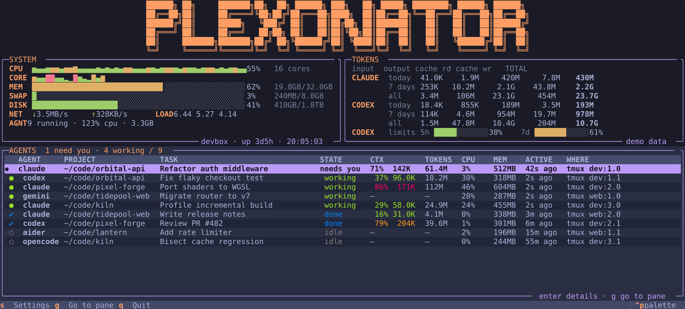

# plexonator

One terminal pane that shows every AI coding agent you have running: which ones need you, what each
one is doing, and how many tokens and how much of your machine they are eating.

Made for people who run a lot of Claude Code, Codex and friends side by side in tmux or cmux.



## Install

Linux and WSL. You need [uv](https://docs.astral.sh/uv/); it fetches Python and the two dependencies on first run.

```sh
git clone https://github.com/EmilSuuronen/plexonator
./plexonator/plexonator.py
```

Want to look around first? `./plexonator.py --demo` runs it on made-up data.

## What you get

- **Agent table.** Every running agent with its project, task, state (working, needs you, done, idle),
  context-window use, session tokens, CPU, memory and pane.
- **Agent details.** Press `enter` on an agent: last prompt, last tool call, last reply, model, branch.
- **Jump to the pane.** Press `g` and tmux or cmux focuses the pane that agent runs in.
- **Token totals.** Today, 7 days and all time for Claude Code and Codex, plus Codex rate limits.
- **System panel.** CPU, memory, swap, disk, network, and what your agents add up to.
- **Themes and settings.** Press `s`; changes apply live and are saved.

| Key | Does |
| --- | --- |
| `↑` `↓` | move between agents |
| `enter` | agent details |
| `g` | go to the agent's pane |
| `s` | settings |
| `q` | quit |

## Exact "needs you" status

By default, state is estimated from log activity. For Claude Code you can make it exact:

```sh
./plexonator.py --install-hooks
```

This adds a small hook to `~/.claude/settings.json` and keeps a backup next to it.
`--uninstall-hooks` removes it. It applies to agents started after you install.

## Open it with every tmux session

Add to `~/.tmux.conf`, with the path you cloned to:

```
set-hook -g session-created 'split-window -h -l 40% ~/plexonator/plexonator.py'
```

## How it works, and its limits

plexonator only reads. It looks at running processes and at the session logs your agents already
write (`~/.claude/projects`, `~/.codex/sessions`). Nothing is sent anywhere.

- Those log formats are undocumented and can change with any agent update.
- Details, context and tokens exist for Claude Code and Codex. Gemini, aider, opencode and amp are
  listed with process data only.
- Claude logs do not state the context window size, so it is assumed to be 200K (1M once a session
  goes past 200K).
- Two agents of the same kind in the same folder can be mixed up outside cmux.
- Pane mapping and `g` work with tmux and cmux. In other terminals you still get the table.

## Development

```sh
./plexonator.py --selftest    # parsers, hooks, status rules and the UI
./docs/make_shots.py          # regenerate the website screenshots from demo data
```

Everything is in `plexonator.py`. The website in `docs/` is a single static page.
